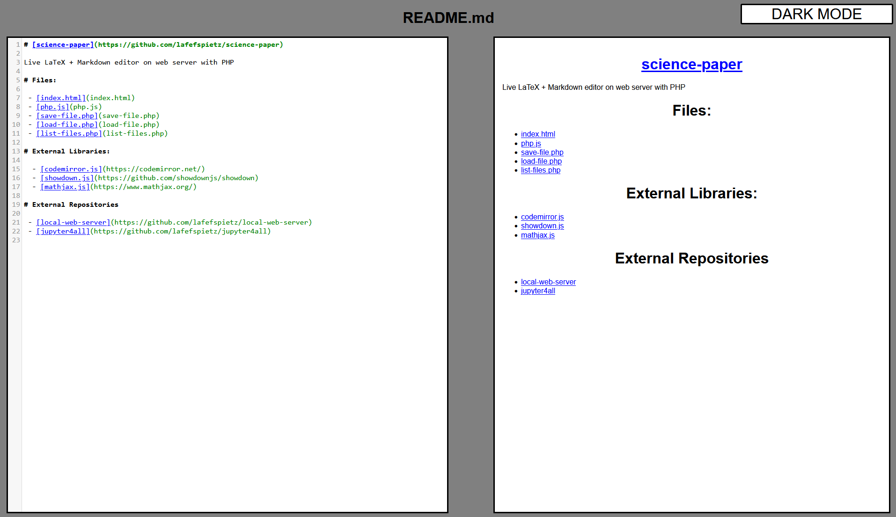
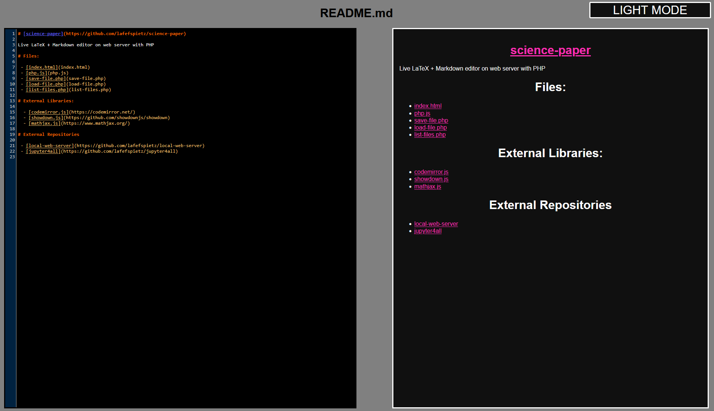

# [science-paper](https://github.com/lafefspietz/science-paper)

Live LaTeX + Markdown editor on web server with PHP

# Files:

 - [index.html](index.html)
 - [php.js](php.js)
 - [save-file.php](save-file.php)
 - [load-file.php](load-file.php)
 - [list-files.php](list-files.php)
 
# External Libraries:
 
  - [codemirror.js](https://codemirror.net/)
  - [showdown.js](https://github.com/showdownjs/showdown)
  - [mathjax.js](https://www.mathjax.org/)
  
# External Repositories

 - [local-web-server](https://github.com/lafefspietz/local-web-server)
 - [jupyter4all](https://github.com/lafefspietz/jupyter4all)

# Screenshots

